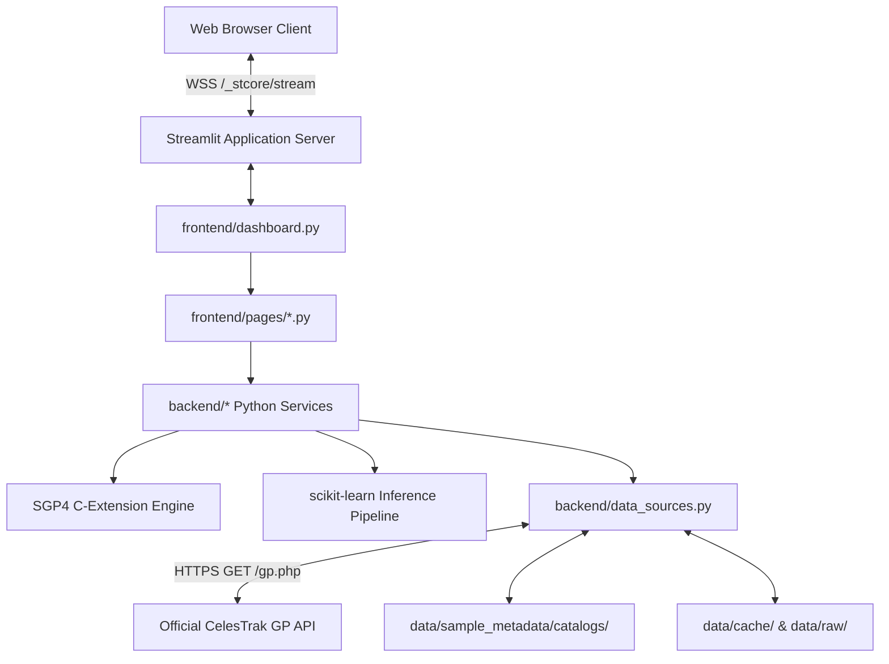

# OrbitalGuard AI ? API and External Service Integration Audit

**Project**: OrbitalGuard AI ? Space Debris Proximity Forecasting & Collision Risk Engine  
**Document**: `docs/API_AND_EXTERNAL_SERVICE_AUDIT.md`  
**Audit Scope**: Internal Python Service Layer, Outbound CelesTrak HTTP APIs, and Platform Ingress  

---

## 1. Application Architecture & Service Boundary

OrbitalGuard AI does **not** implement an ad-hoc REST/Flask/FastAPI microservice layer. Instead, it utilizes an architecturally coherent **monolithic Python Streamlit architecture**:
- **Frontend Controller**: Multi-page router (`frontend/dashboard.py`) dispatching to individual renderers in `frontend/pages/`.
- **Domain Service Layer**: In-memory Python services implementing business logic (`backend/*.py`).
- **Data Ingestion Layer**: `DataSourceService` managing HTTP communication with CelesTrak, local disk cache, and offline snapshots.



---

## 2. External HTTP Service Integration (CelesTrak GP API)

### 2.1 Specification
- **Base Endpoint**: `https://celestrak.org/NORAD/elements/gp.php`
- **Supported Query Parameters**:
  - `GROUP`: Selected satellite group (e.g. `stations`, `science`, `visual`, `weather`, `gps-ops`, `cubesat`, `cosmos-2251-debris`, `iridium-33-debris`).
  - `CATNR`: 5-digit NORAD catalog number (e.g. `25544` for ISS, `20580` for Hubble).
  - `NAME`: Satellite name query string.
  - `FORMAT`: Strictly `TLE` (enables line checksum and mean element validation).
- **Transport Settings**:
  - `Connection Timeout`: **15.0 seconds** (provides sufficient margin for container DNS and TLS negotiation).
  - `Read Timeout`: **30.0 seconds** (accommodates large TLE payloads).
  - `Retries`: Max 2 attempts with exponential backoff (`1.5s`, `3.0s`).
  - `Headers`:
    ```http
    User-Agent: Mozilla/5.0 (Windows NT 10.0; Win64; x64) AppleWebKit/537.36 (KHTML, like Gecko) Chrome/124.0.0.0 Safari/537.36 (compatible; OrbitalGuardAI/0.1.0; +https://orbitguardai.streamlit.app/)
    Accept: text/plain, */*
    Accept-Encoding: gzip, deflate
    ```

### 2.2 Status Code & Failure Taxonomy
- `200 OK`: Valid TLE payload parsed and validated via `TLEValidationService`.
- `400, 401, 403, 404, 405, 410`: Permanent HTTP error; immediately raises `DataSourceError` without useless retrying.
- `429 Too Many Requests`: Respects upstream `Retry-After` header; raises `RateLimitedError` after backoff.
- `500, 502, 503, 504`: Transient server/gateway error; retries up to 2 times before raising `DataSourceError`.
- `ConnectTimeout`: Upstream firewall or network delay; triggers automatic offline snapshot fallback.
- `ReadTimeout`: Server responding too slowly; triggers automatic offline snapshot fallback.

---

## 3. Investigation & Final Classification of `/api/v2/user/details` HTTP 404

### 3.1 Observed Console Errors
Browser developer tools record repeated HTTP 404 responses for:
```text
https://orbitguardai.streamlit.app/api/v2/user/details -> 404 Not Found
```

### 3.2 Technical Verification
1. **Source Code Inspection**:
   - Grepped the entire repository: **0 occurrences** of `user/details` or `/api/v2`.
2. **Network Callstack Origin**:
   - The request is initiated by `cn-BZMAGw-p.js:1`, the **Streamlit Community Cloud React Host Viewer Shell** (`share.streamlit.io`).
   - The hosting wrapper embeds the application in an iframe and renders the platform toolbar:
     - Top navigation bar: "Share", "Deploy"
     - Bottom-right floating drawer: "< Manage app"
   - To check user authorization permissions (e.g. whether the current browser session has ownership rights to view container logs, reboot the container, or manage secrets), the host wrapper polls `/api/v2/user/details`.
3. **Reason for 404**:
   - On custom application subdomains (`*.streamlit.app`), the reverse proxy forwards application WebSocket connections to the Python container.
   - The platform account API (`/api/v2/user/details`) is hosted on the parent domain `share.streamlit.io`. When queried against the child subdomain by an unauthenticated visitor, the gateway returns HTTP 404.

### 3.3 Engineering Classification & Policy
- **Classification**: Third-party hosting infrastructure request.
- **Architectural Policy**: OrbitalGuard AI does not have user accounts or authentication. Creating a dummy `/api/v2/user/details` route inside the application would be artificial and misleading. The 404 is documented as an expected consequence of Streamlit Cloud's hosting architecture.

---

## 4. Multi-Tier Offline Data Architecture

To ensure 100% operational uptime independent of external network availability or upstream rate limits:
1. **Tier 1 (Live API)**: Queries CelesTrak with 15s connect timeout and browser User-Agent.
2. **Tier 2 (Local Cache)**: Validates against `data/cache/*.tle` if queried within 6-hour TTL.
3. **Tier 3 (Verified Bundled Catalogs)**: Automatically loads verified public snapshots from `data/sample_metadata/catalogs/*.tle` (stations, science, visual, weather, gps-ops, cubesat, debris).
4. **Tier 4 (Bundled Historical Sample)**: Universal 4-satellite sample in `data/sample_metadata/sample_catalog.tle`.
5. **Tier 5 (User Upload)**: Custom TLE/3LE upload validated up to 2 MB.
