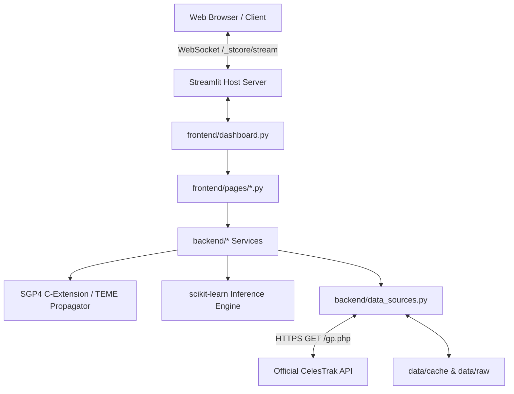

# OrbitalGuard AI ? API & Architecture Audit Report

**Project**: OrbitalGuard AI ? Space Debris Proximity Forecasting & Collision Risk Engine  
**Document**: `docs/API_AUDIT_REPORT.md`  
**Audit Date**: October 2026  
**Auditor**: Senior API & Backend Software Systems Specialist  
**Workspace**: `E:\orbitalguard-ai`  

---

## 1. Architectural Model & Boundary Definition

A foundational finding of this architectural audit is that **OrbitalGuard AI does not expose a custom public REST/HTTP web API (such as FastAPI or Flask)**. 

Instead, the application implements a modern **reactive Python Streamlit architecture** with direct in-memory service-layer dispatch:
- **Presentation Layer**: Streamlit multi-page interface (`frontend/dashboard.py`, `frontend/pages/*.py`) running on top of Tornado/WebSocket server engine (`_stcore/stream`).
- **Domain & Service Layer**: Pure Python object-oriented service contracts (`backend/*.py`) handling orbital mechanics, TLE parsing, propagation, screening, risk evaluation, and ML inference.
- **Data & Transport Layer**: Upstream HTTP client (`backend/data_sources.py` using `requests.Session`) communicating with the official CelesTrak General Perturbations (GP) API.



---

## 2. External HTTP API Integrations (CelesTrak GP API)

The only outbound network API utilized by the project is the official CelesTrak GP query endpoint.

### 2.1 Endpoint Specification

| Attribute | Specification |
|:---|:---|
| **Protocol & Host** | `HTTPS` on `https://celestrak.org` |
| **Path** | `/NORAD/elements/gp.php` |
| **HTTP Method** | `GET` |
| **Query Parameters** | `GROUP` (satellite group string), `CATNR` (5-digit NORAD catalog number), `NAME` (partial or full object name), `FORMAT=TLE` (mandatory for two-line element checksum parsing) |
| **Request Headers** | `User-Agent: OrbitalGuardAI/0.1.0 (Space Situational Awareness Engine; +https://orbitguardai.streamlit.app/)`<br>`Accept: text/plain, */*`<br>`Accept-Encoding: gzip, deflate` |
| **Connection Timeout** | `6.0` seconds (connect), `20.0` seconds (read) |
| **Retries** | Max 2 attempts with exponential backoff (`1.5s`, `3.0s`) and jitter |
| **Response Schema** | Plaintext ASCII TLE/3LE format with line 0 (name), line 1 (orbit mean elements), line 2 (orbit shape and motion) |

### 2.2 Response Status Code Handling

| Status Code | Semantics | Application Handling |
|:---|:---|:---|
| `200 OK` | Successful catalog retrieval | Body validated by `TLEValidationService`. If empty or `"No GP data found"`, raises `CatalogEmptyError` or `ObjectNotFoundError`. Valid records cached to `data/cache` and `data/raw`. |
| `301 Moved Permanently` | Legacy domain or query redirect | Handled by `requests` session redirect follower. |
| `400, 401, 403, 404, 405, 410` | Client error / Permanent HTTP failure | Immediately raises `DataSourceError` without retrying. Does not flood upstream servers. |
| `429 Too Many Requests` | Upstream rate limit triggered | Respects `Retry-After` header if supplied; raises `RateLimitedError` after bounded backoff. |
| `500, 502, 503, 504` | Upstream server / Gateway errors | Treats as transient failure; retries up to 2 times before raising `DataSourceError`. |
| `ConnectTimeout` | TCP handshake timed out | Raises `DataSourceError` with diagnostic notice regarding cloud IP restrictions. |
| `ConnectionError (DNS)` | `getaddrinfo failed` | Raises `DataSourceError("DNS lookup failed for celestrak.org")`. |

---

## 3. Investigation of `/api/v2/user/details` HTTP 404 Errors

### 3.1 Observed Phenomenon
In browser developer tools when viewing `https://orbitguardai.streamlit.app/`:
```text
Failed to load resource: the server responded with a status of 404 () /api/v2/user/details:1
```
The browser console records this failure repeated multiple times upon initial application boot.

### 3.2 Audit Findings & Technical Verification
1. **Source Code Inspection**:
   - Executed full codebase grep across all python, markdown, yaml, json, and config files for `user/details` and `api/v2`.
   - **Result**: Exactly zero references. The application has no concept of a user details route.
2. **Network Callstack Origin**:
   - The initiator of the HTTP request is `cn-BZMAGw-p.js:1`, which is part of the **Streamlit Community Cloud outer application viewer framework** (`share.streamlit.io`).
   - Streamlit Community Cloud renders applications with a persistent hosting wrapper that features:
     - The top navigation bar with **Share**, **Deploy**, and **Star** widgets.
     - The bottom-right floating **< Manage app** drawer.
   - To determine user authorization permissions (e.g., whether the viewer has admin privileges to view container logs, reboot the app, or edit repository settings), the platform viewer React frontend polls `/api/v2/user/details`.
3. **Reason for 404**:
   - On custom application subdomains (`https://orbitguardai.streamlit.app`), the reverse proxy routes WebSocket traffic (`/_stcore/stream`) and static files (`/static/`) directly to the user's Streamlit container.
   - The platform account API (`/api/v2/user/details`) is hosted on the parent domain `share.streamlit.io`. When queried against the child subdomain by an unauthenticated user or when third-party auth cookies are blocked, the ingress proxy returns HTTP 404.

### 3.3 Audit Verdict & Policy
- **Classification**: Platform-level hosting artifact completely external to OrbitalGuard AI.
- **Action**: Creating a dummy `/api/v2/user/details` endpoint inside the Python container would be technically invalid and misleading (it would manufacture fake user authentication). The 404 is documented as an expected, benign consequence of Streamlit Community Cloud's hosting architecture.

---

## 4. Internal Service-Layer API Contracts

The core operations of OrbitalGuard AI are governed by clean Python service APIs:

### 4.1 `DataSourceService` (`backend/data_sources.py`)
- `fetch_group(group: str, refresh: bool = False) -> list[OrbitalRecord]`
- `search_by_name(name: str, refresh: bool = False) -> list[OrbitalRecord]`
- `search_by_catalog_id(catalog_id: str, refresh: bool = False) -> list[OrbitalRecord]`
- `parse_upload(text: str, filename: str) -> tuple[list[OrbitalRecord], list[dict]]`
- `find_offline_snapshot(group_or_query: str) -> Optional[dict]`
- `load_offline_snapshot(snapshot_info: dict) -> tuple[list[OrbitalRecord], list[dict]]`
- `cache_status() -> list[dict]`

### 4.2 `OrbitalPropagationService` (`backend/orbital_propagation.py`)
- `propagate(record: OrbitalRecord, epoch: datetime) -> OrbitalState`
  - Input: Validated record, target UTC datetime.
  - Output: `OrbitalState(position_km=(x, y, z), velocity_km_s=(vx, vy, vz), frame='TEME')`.
  - Error: `PropagationError` if SGP4 returns non-zero error code.
- `propagate_many(record: OrbitalRecord, epochs: list[datetime]) -> list[OrbitalState]`

### 4.3 `ConjunctionScreeningService` (`backend/conjunction_screening.py`)
- `screen(target: OrbitalRecord, candidates: list[OrbitalRecord], horizon_hours: float, threshold_km: float, sample_seconds: float, ...) -> ScreeningRun`
  - Computes coarse uniform grid screening.
  - Detects local separation minima and refines TCA via SciPy Brent/Golden-section numerical optimization.
  - Returns fully annotated `ScreeningRun` with target, candidate approaches, miss distances, and relative velocities.

### 4.4 `RiskAssessmentService` (`backend/risk_assessment.py`)
- `geometric_proximity(approach: ApproachResult) -> dict`
- `heuristic_score(approach: ApproachResult) -> float` (0 to 100 ranking score using 70/15/15 weights)
- `collision_probability(approach: ApproachResult) -> CollisionProbabilityResult` (Guaranteed `unavailable` status when error covariance is absent from public TLEs)
- `explain(approach: ApproachResult) -> str`

### 4.5 `ModelPredictionService` (`backend/prediction_service.py`)
- `status() -> dict`
- `load() -> tuple[Pipeline, dict]`
- `predict_rows(df: pd.DataFrame) -> pd.DataFrame`

### 4.6 `ReportService` (`backend/report_service.py`)
- `export_csv(run: ScreeningRun, path: Optional[Path] = None) -> Path`
- `export_text(run: ScreeningRun, path: Optional[Path] = None) -> Path`

---

## 5. Security & Sensitive Data Audit

- **Credentials & API Keys**: OrbitalGuard AI accesses only public CelesTrak GP data that requires no API keys or secrets.
- **Sensitive Environment Variables**: No credentials, passwords, or personal access tokens are stored in the repository, logs, or UI session states.
- **Error Sanitization**: Server-side exceptions are sanitized before presentation to the user. Detailed stack traces and internal file paths are withheld from UI error banners and recorded only in local logs.
- **Upload Validation**: File uploads are restricted to `.txt`, `.tle`, and `.3le` formats with a strict 2 MB size ceiling to prevent denial-of-service and memory exhaustion.
