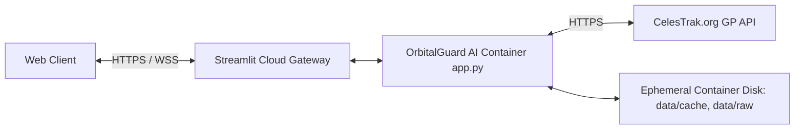

# OrbitalGuard AI ? Deployment and Operational Guide

**Project**: OrbitalGuard AI ? Space Debris Proximity Forecasting & Collision Risk Engine  
**Document**: `docs/DEPLOYMENT.md`  
**Public Deployment**: [https://orbitguardai.streamlit.app/](https://orbitguardai.streamlit.app/)  
**Primary Target Platform**: Streamlit Community Cloud (Linux / Debian / AWS EC2)  
**Local Target Platform**: Windows 11 / Linux / macOS with Python 3.11, 3.12, or 3.13  

---

## 1. Cloud Architecture & Hosting Environment

The live deployment at `orbitguardai.streamlit.app` is hosted on **Streamlit Community Cloud**, an infrastructure managed by Snowflake:
- **Operating System**: Debian Linux container on AWS EC2 (`us-east-1`).
- **Entrypoint**: `app.py` invoking `frontend.dashboard.run()`.
- **Dependencies**: Ingested automatically from `requirements.txt`.
- **Web Server**: Streamlit Tornado server running WebSocket engine over port `8501`.



---

## 2. Cloud Network Constraints & Solutions

### 2.1 The Shared NAT Gateway Problem
Streamlit Community Cloud hosts thousands of open-source applications inside shared container pools. All outbound HTTP queries originate from a limited pool of shared AWS NAT Gateway IP addresses.
- **Upstream Rate Limiting**: The official CelesTrak service (`celestrak.org`) implements strict automated bot and scraper mitigation rules via Cloudflare.
- **The Consequence**: When multiple cloud applications query CelesTrak simultaneously from the same shared AWS IP addresses, CelesTrak may drop or throttle TCP connections, resulting in connection timeouts.

### 2.2 Built-in Mitigations in OrbitalGuard AI
OrbitalGuard AI is specifically hardened against these cloud hosting constraints:
1. **Application User-Agent**: Configures a distinct User-Agent header:
   ```text
   User-Agent: OrbitalGuardAI/0.1.0 (Space Situational Awareness Engine; +https://orbitguardai.streamlit.app/)
   ```
   This adheres to CelesTrak's M2M usage policy, distinguishing the application from anonymous Python scripts.
2. **Split Connection & Read Timeouts**:
   - Connection timeout: `6.0` seconds (avoids multi-minute UI freezes).
   - Read timeout: `20.0` seconds.
3. **Automatic Offline Snapshot Discovery**:
   - When a live query experiences a timeout on Streamlit Cloud, `DataSourceService.find_offline_snapshot()` automatically checks the container disk for pre-packaged raw or cached catalog files.
   - The UI immediately presents a one-click button: **Load offline snapshot** or **Load bundled sample catalog**.
   - The user is never left in a frozen or broken state.

---

## 3. Configuration & Environment Variables

All settings can be configured via environment variables or a `.env` file at the project root:

| Variable | Type | Default | Description |
|:---|:---:|:---:|:---|
| `CELESTRAK_BASE_URL` | string | `https://celestrak.org/NORAD/elements/gp.php` | Upstream CelesTrak General Perturbations endpoint. |
| `CONNECT_TIMEOUT_SECONDS` | float | `6.0` | Socket connection establishment timeout in seconds. |
| `READ_TIMEOUT_SECONDS` | float | `20.0` | Socket read/transfer timeout in seconds. |
| `MAX_RETRIES` | integer | `2` | Maximum retry attempts for transient HTTP failures. |
| `CACHE_TTL_SECONDS` | integer | `21600` (6 hours) | Cache expiration time for fetched TLE catalogs. |
| `CELESTRAK_USER_AGENT` | string | `OrbitalGuardAI/0.1.0 (...)` | Identifying User-Agent header. |

---

## 4. Local Deployment Instructions (Windows PowerShell)

### 4.1 Prerequisites
- Python 3.11, 3.12, or 3.13 installed and added to `PATH`.
- Git installed.

### 4.2 Step-by-Step PowerShell Execution
```powershell
# 1. Clone repository and navigate to workspace
git clone https://github.com/your-username/orbitalguard-ai.git
cd orbitalguard-ai

# 2. (Optional) Create and activate a clean virtual environment
python -m venv .venv
.\.venv\Scripts\Activate.ps1

# 3. Install required dependencies
pip install -r requirements.txt

# 4. Execute preflight validation
python scripts/run_preflight.py

# 5. Execute automated test suite
pytest -v

# 6. Launch the Streamlit application
streamlit run app.py
```
The dashboard will open automatically in your browser at `http://localhost:8501`.

---

## 5. Troubleshooting Cloud Deployments

### Issue A: "CelesTrak request timed out" in Cloud UI
- **Cause**: Upstream CelesTrak rate-limiting against shared cloud NAT IP addresses.
- **Solution**:
  1. Click **Load bundled sample (offline)** on the Satellite Selection page to load the verified 4-object historical catalog.
  2. Or click **Load offline {group} snapshot** if available.
  3. Or upload any custom `.tle` or `.3le` file via the file uploader.

### Issue B: Browser Console Shows `/api/v2/user/details` 404
- **Cause**: Streamlit Community Cloud platform host wrapper polling for platform user authentication.
- **Impact**: Zero impact on OrbitalGuard AI. It is a harmless platform infrastructure diagnostic.

### Issue C: Plotly Datetime Error on Conjunction Plots
- **Cause**: In Plotly 5.24+, calling `fig.add_vline(x=datetime)` triggers an internal `sum()` operation on datetime objects.
- **Solution**: OrbitalGuard AI uses `fig.add_shape(type='line', yref='paper')` with `fig.add_annotation()` to guarantee cross-version compatibility.
