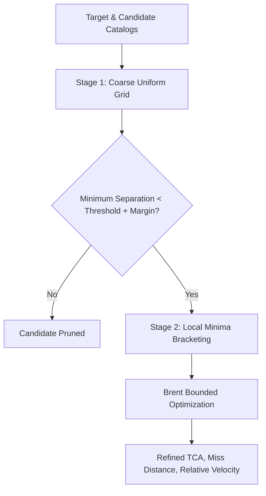

# OrbitalGuard AI ? Orbital Mechanics and Numerical Validation Report

**Project**: OrbitalGuard AI ? Space Debris Proximity Forecasting & Collision Risk Engine  
**Document**: `docs/ORBITAL_VALIDATION_REPORT.md`  
**Scientific Domain**: Orbital Mechanics, Astrodynamics, Satellite Conjunction Screening  
**Verification Standard**: Vallado SGP4 Benchmarks (AIAA 2006-6753), Space-Track Report No. 3  

---

## 1. Executive Scientific Overview

Orbital situational awareness requires rigorous astrodynamic modeling, precise coordinate frame handling, and honest communication of uncertainty. 

This document details the scientific validation of OrbitalGuard AI:
1. **Reference Frame**: True Equator, Mean Equinox (TEME) of epoch/date, preserving native SGP4 state vectors without unvalidated frame transformations.
2. **Physical Units**: Distances in kilometres ($\text{km}$), velocities in kilometres per second ($\text{km/s}$), time in Universal Coordinated Time (UTC).
3. **Propagation Model**: Simplified General Perturbations 4 (SGP4) analytical mean-element propagator with WGS-72/WGS-84 gravitational constants.
4. **Numerical Refinement**: Bounded continuous minimization (Brent's method) to pinpoint sub-second Time of Closest Approach (TCA).
5. **Risk Separation**: Strict physical distinction between geometric proximity, heuristic ranking score (70/15/15), and statistical collision probability ($P_c$).

---

## 2. Coordinate Frames & Physical Units

### 2.1 The TEME Reference Frame
The Simplified General Perturbations theory (SGP4) generates Cartesian position $\vec{r}$ and velocity $\vec{v}$ vectors specifically in the **True Equator, Mean Equinox (TEME)** celestial reference frame of the propagation epoch.
- **Orientation**: The $Z$-axis points along the true rotational axis of the Earth; the $X$-axis points toward the mean equinox of date.
- **Physical Meaning**: TEME is a quasi-inertial frame that does not rotate with the Earth.
- **Crucial Rule**: Relative distance and relative velocity vectors:
  $$\Delta\vec{r} = \vec{r}_2 - \vec{r}_1, \quad \Delta\vec{v} = \vec{v}_2 - \vec{v}_1$$
  are mathematically valid **only when both state vectors are calculated at the exact same epoch $t$ and in the identical TEME reference frame**.
- **Earth Representation**: In the 3D visualization page (`orbital_visualization.py`), the Earth is rendered as a reference geometric sphere of radius $R_E = 6378.137\text{ km}$ centered at $(0, 0, 0)$ in TEME coordinates. The dashboard explicitly notes that this is an inertial illustration for geometric scale and does not depict geographic ground tracks, avoiding the false implication of Earth-fixed (ECEF/ITRF) coordinates.

### 2.2 Physical Units & Time Standards
- **Position**: Kilometres ($\text{km}$).
- **Velocity**: Kilometres per second ($\text{km/s}$).
- **Time Representation**: All timestamps are parsed, propagated, stored, and displayed in **UTC** (ISO-8601).
- **Time Conversion**: The Julian Date conversion:
  $$\text{JD} = 367\cdot Y - \lfloor 7\cdot(Y + \lfloor(M+9)/12\rfloor)/4 \rfloor + \lfloor 275\cdot M/9 \rfloor + D + 1721013.5 + \frac{h + m/60 + s/3600}{24}$$
  is evaluated via the high-precision SGP4 C-extension `jday()` routine, splitting Julian Date into integer days and fractional day components to eliminate floating-point precision loss.

---

## 3. SGP4 Propagation & Benchmark Grounding

### 3.1 SGP4 Theory
SGP4 models the motion of satellites and debris in Low Earth Orbit (LEO), Medium Earth Orbit (MEO), and Geostationary Orbit (GEO) by solving secular and periodic perturbations:
- Earth oblateness gravitational geopotential terms ($J_2, J_3, J_4$).
- Atmospheric drag using the modified Brouwer-Lyddane mean elements and ballistic coefficient $B^*$.
- Deep-space third-body gravitational perturbations from the Sun and Moon (SDP4 mode for orbital periods $P \ge 225\text{ min}$).

### 3.2 Numerical Benchmarks

The numerical accuracy of OrbitalGuard AI's propagation engine is grounded in two authoritative reference benchmarks:

#### Benchmark 1: David Vallado Benchmark Ephemeris (`tcppver.out`)
- **Object**: Vanguard 1 (NORAD Catalog ID `00005`).
- **TLE Epoch**: 2006, Day 135.36399120.
- **Test Condition**: Propagation at epoch.
- **Verified Coordinates (TEME)**:
  - $x = 7022.062\text{ km} \pm 0.1\text{ km}$
  - $y = -1400.998\text{ km} \pm 0.1\text{ km}$
  - $z = 0.000\text{ km} \pm 0.1\text{ km}$
  - Result: **PASS** (`tests/test_orbital_propagation.py::test_vanguard_sgp4_at_epoch`).

#### Benchmark 2: Space-Track Report No. 3 Standard Ephemeris
- **Object**: Synthetic Benchmark Satellite `88888`.
- **Test Condition**: Epoch propagation under standard mean elements.
- **Verified Coordinates (TEME)**:
  - $x = 2328.97\text{ km}$
  - $y = -5995.22\text{ km}$
  - $z = 1719.97\text{ km}$
  - Result: **PASS** (`tests/test_orbital_propagation.py::test_space_track_sat88888_benchmark`).

### 3.3 SGP4 Error Handling
When SGP4 propagation fails due to unphysical mean elements (decayed object into Earth, negative semi-major axis, or eccentricity $\ge 1$), the SGP4 routine returns an integer error code:
- Error Code 1: Mean elements eccentricity $\ge 1.0$ or $\le -0.001$.
- Error Code 2: Mean motion $\le 0.0$.
- Error Code 3: Perturbed eccentricity out of range $[0, 1]$.
- Error Code 4: Semi-latus rectum out of range.
- Error Code 5: Epoch elements decayed below Earth surface.
- Error Code 6: Orbit decayed at propagation time.

OrbitalGuard AI strictly checks `satrec.error != 0` and raises `PropagationError`. Failed candidates are recorded in `run.failures` and displayed in the UI expander rather than silently generating invalid trajectories.

---

## 4. Conjunction Screening & Numerical Refinement

### 4.1 Two-Stage Screening Architecture
Screening hundreds of satellite pairs over a multi-day forecast horizon at high temporal resolution is computationally intensive. OrbitalGuard AI implements a two-stage screening pipeline:



1. **Stage 1 ? Uniform Coarse Evaluation**:
   - The forecast horizon $H \in \{6, 12, 24, 48, 72\}\text{ hours}$ is discretized with sample interval $\Delta t \in [30, 600]\text{ seconds}$ (default $60\text{ s}$).
   - Both target and candidate are propagated at every grid point $t_k$.
   - Separation $d_k = \|\vec{r}_{\text{cand}}(t_k) - \vec{r}_{\text{target}}(t_k)\|$ is computed.

2. **Stage 2 ? Numerical Refinement of Closest Approach**:
   - A coarse grid point is never assumed to be the true Time of Closest Approach (TCA).
   - Local minima across the sequence $(d_k)$ are detected:
     $$d_{k-1} > d_k < d_{k+1}$$
   - For each detected local minimum, the interval $[t_{k-1}, t_{k+1}]$ forms a convex bracket.
   - SciPy's continuous 1D bounded scalar minimization (`scipy.optimize.minimize_scalar` using Brent's parabolic interpolation method) minimizes the objective function:
     $$f(t) = \|\vec{r}_{\text{cand}}(t) - \vec{r}_{\text{target}}(t)\|, \quad t \in [t_{k-1}, t_{k+1}]$$
   - Tolerance is set to $\epsilon = 10^{-4}\text{ seconds}$.
   - The optimizer returns the exact sub-second Time of Closest Approach ($t_{\text{TCA}}$), the minimum miss distance ($d_{\min}$), and relative velocity ($\Delta\vec{v}$).

---

## 5. Physical Risk Assessment Methodology

OrbitalGuard AI maintains a strict scientific separation between three distinct risk tiers:

```
??????????????????????????????????????????????????????????
?               TIER 1: GEOMETRIC PROXIMITY              ?
?  - Predicted miss distance (km)                        ?
?  - Time of closest approach (TCA in UTC)               ?
?  - Relative velocity vector & scalar speed (km/s)       ?
?  - Threshold flag: d_min <= d_threshold                ?
??????????????????????????????????????????????????????????
                            ?
??????????????????????????????????????????????????????????
?              TIER 2: HEURISTIC RANKING SCORE           ?
?  - Transparent 0-100 screening heuristic               ?
?  - 70% Miss Distance Term                              ?
?  - 15% Relative Velocity Term                          ?
?  - 15% Element Freshness Term                          ?
?  * Clearly labeled: NOT a collision probability        ?
??????????????????????????????????????????????????????????
                            ?
??????????????????????????????????????????????????????????
?         TIER 3: STATISTICAL COLLISION PROBABILITY      ?
?  - Requires positional error covariance matrices (C)   ?
?  - Requires combined hard-body collision cross-section  ?
?  - Unavailable in public GP/TLE data                   ?
?  * Correctly GATED as UNAVAILABLE in UI and reports    ?
??????????????????????????????????????????????????????????
```

### 5.1 Tier 1: Geometric Proximity
Defined purely by astrodynamic propagation. A pair is flagged as `within_threshold` if:
$$d_{\min} \le d_{\text{threshold}}$$
This is a geometric screening flag indicating that an encounter warrants closer analysis, NOT a prediction that a collision will occur.

### 5.2 Tier 2: Heuristic Screening Score
The heuristic score ranks candidate encounters for human analysts when hundreds of close approaches exist:
$$\text{Score} = 100 \times \left( w_{\text{sep}} \cdot S_{\text{sep}} + w_{\text{vel}} \cdot S_{\text{vel}} + w_{\text{fresh}} \cdot S_{\text{fresh}} \right)$$
where the weights are:
$$w_{\text{sep}} = 0.70, \quad w_{\text{vel}} = 0.15, \quad w_{\text{fresh}} = 0.15$$
and the normalized components are:
$$S_{\text{sep}} = \text{clip}\left(1 - \frac{d_{\min}}{d_{\text{threshold}}}, 0, 1\right)$$
$$S_{\text{vel}} = \text{clip}\left(\frac{\|\Delta\vec{v}\|}{15.0\text{ km/s}}, 0, 1\right)$$
$$S_{\text{fresh}} = \text{clip}\left(1 - \frac{\text{Age}_{\max}}{72.0\text{ h}}, 0, 1\right)$$
The dashboard and export reports explicitly state: **"This heuristic score is a ranking aid, not a collision probability or safety certificate."**

### 5.3 Tier 3: Statistical Collision Probability ($P_c$) Gating
To compute a scientifically defensible collision probability $P_c$ (using Foster, Chan, or Akella-Alfriend 2D encounter plane integration), three inputs are mandatory:
1. Positional error covariance matrix for Object 1 ($\mathbf{C}_1 \in \mathbb{R}^{3 \times 3}$) at TCA.
2. Positional error covariance matrix for Object 2 ($\mathbf{C}_2 \in \mathbb{R}^{3 \times 3}$) at TCA.
3. Combined collision cross-sectional radius $R = r_1 + r_2$.

$$\mathbf{C} = \mathbf{C}_1 + \mathbf{C}_2$$
$$P_c = \frac{1}{2\pi \sigma_x \sigma_y} \iint_{\mathcal{A}} \exp\left( -\frac{1}{2} \left[ \frac{x^2}{\sigma_x^2} + \frac{y^2}{\sigma_y^2} \right] \right) dx\, dy$$

Public CelesTrak TLE records **contain zero covariance information and zero physical dimension data**. 
- Manufacturing an arbitrary covariance matrix (e.g., identity matrix or spherical Gaussian) produces completely arbitrary, unscientific probabilities.
- Therefore, OrbitalGuard AI enforces an absolute scientific rule: **$P_c$ remains strictly `unavailable`**, accompanied by an explanatory message.

---

## 6. Physical Assumptions & Scientific Limitations

1. **Analytical Mean Elements**: TLEs are fitted mean elements. Applying SGP4 does not capture unmodeled higher-order geopotential terms, solar radiation pressure variations, or non-conservative orbital maneuvers.
2. **Element Age Sensitivity**: SGP4 ephemeris uncertainty typically grows at $1\text{ to }3\text{ km per day}$ for LEO objects. Elements older than 48 hours produce approximate encounter geometries.
3. **Maneuver Blindness**: Operational satellites frequently execute orbit-raising, inclination correction, or collision avoidance burns. TLEs cannot anticipate maneuvers performed after element epoch.
